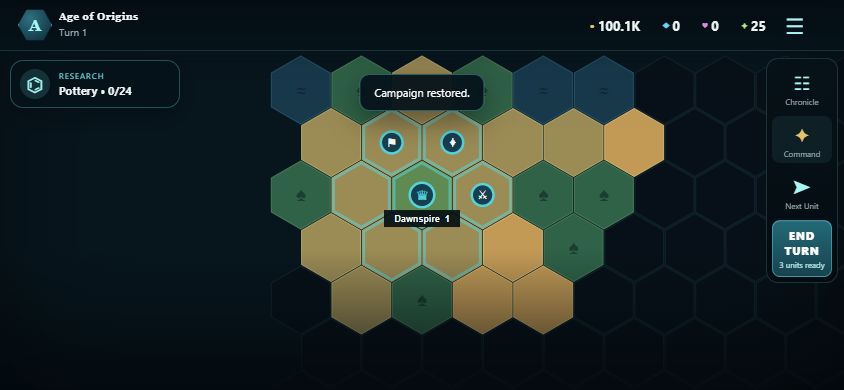

# Empire Command Mobile

[](https://github.com/CarlosA49/Empire-Command-Mobile/actions/workflows/ci.yml)



Empire Command Mobile is a separate, clean-room pocket 4X game built for touch screens. It runs in Android, iPhone/iPad, and modern browsers, and includes an offline single-player Command Console.

It does **not** modify, patch, decode, or redistribute any Civilization VII file. The installed retail game is a 13.76 GB Windows x64 build with no Android/iOS engine source, so it cannot honestly be recompiled into a native phone game from the retail installation. This project provides:

1. a standalone reconstructed mobile strategy game that runs on the phone itself; and
2. a supported route for playing the exact PC game on a phone through Steam Link.

This independent project is not affiliated with or endorsed by Firaxis Games, 2K, or Take-Two Interactive. It contains no Civilization VII source code, binaries, artwork, audio, or extracted assets.

## Downloads

- [Android APK](https://github.com/CarlosA49/Empire-Command-Mobile/releases/download/v0.1.0/EmpireCommand-Mobile-Android-v0.1.0.apk) — install directly on Android 7.0 or later
- [iPhone/iPad Xcode package](https://github.com/CarlosA49/Empire-Command-Mobile/releases/download/v0.1.0/EmpireCommand-Mobile-iOS-Xcode-v0.1.0.zip) — compile and sign on a Mac
- [SHA-256 checksums](release/SHA256SUMS.txt)

## What is playable

- Procedural hex worlds in three sizes
- Four empires with computer-controlled opponents
- Touch pan, pinch zoom, selection, movement, combat, and city management
- Settlers, six unit types, six buildings, resources, fog of war, and territory
- Thirteen technologies across three ages
- City food, growth, production, yields, and expansion
- Domination, Science, and turn-80 Legacy victories
- Automatic local saves and offline PWA support
- Portrait, landscape, phone, tablet, mouse, and keyboard layouts
- Custom Android/iOS icons and splash screens

## Command Console

Tap **Command** in the bottom dock. Commands affect only the current offline campaign:

- +100K Gold, +10K Influence, +100K Science, +100K Culture
- Unlock all technologies and finish city production
- Heal all and restore movement
- Reveal Map, Infinite Movement, God Mode, and One-Hit Combat toggles
- Spawn a Settler or Legion
- Advance to the next age

Toggle state is saved with the campaign so it cannot silently turn itself on after a reload.

## Play it on this PC

Node 22 or newer is required.

```powershell
cd "D:\Program Files\Steam\steamapps\common\Sid Meier's Civilization VII\Civ7-Mobile"
npm install
npm start
```

Open `http://localhost:4177`. Another device on the same Wi-Fi can use this PC's LAN address and port `4177`, although installable PWA/offline mode requires HTTPS outside localhost.

## Android app

An installable APK is provided at `release/EmpireCommand-Mobile-Android-v0.1.0.apk`.

1. Copy the APK to an Android phone or tablet.
2. Open it in the Files app.
3. If Android asks, allow that Files/browser app to install unknown apps.
4. Tap **Install**, then launch **Empire Command Mobile**.

The APK supports Android 7.0 and later and is development-signed for direct installation. The editable Android Studio project remains in `android/`. To rebuild it:

1. Install Android Studio and an Android SDK (API 24+).
2. Run `npm install` and `npm run mobile:sync` here.
3. Run `npm run android:open`.
4. In Android Studio, choose **Build > Build APK(s)** or run `android\gradlew.bat assembleDebug` after the SDK is configured.

The debug APK is written to `android/app/build/outputs/apk/debug/`.

## iPhone and iPad app

The ready-to-sign Xcode app is provided at `release/EmpireCommand-Mobile-iOS-Xcode-v0.1.0.zip`, and its editable project is in `ios/`. Apple requires macOS, Xcode, and an Apple development identity for the final signed iPhone/iPad build:

1. Copy the ZIP to a Mac and extract it.
2. Open `ios/App/App.xcodeproj` in Xcode 26 or newer.
3. Select your Apple development team, connect the iPhone/iPad, and press **Run**.

The app targets iOS/iPadOS 15+. Windows cannot create Apple's signed IPA, because that step depends on Xcode and your signing identity. Detailed steps are in `IOS-BUILD.md`; see also the official [Capacitor iOS guide](https://capacitorjs.com/docs/ios) and [environment requirements](https://capacitorjs.com/docs/getting-started/environment-setup).

For a no-Xcode option, host `www/` on HTTPS, open it in Safari, use **Share > Add to Home Screen**, and it will run as an offline-capable full-screen web app.

## Play the exact Civilization VII PC game on a phone

Use Valve's Steam Link app. Keep this PC on with Steam running, install Steam Link on Android or iPhone, pair it with the PC, and launch Civilization VII from the Steam library. This streams the real Windows build while sending touch/controller input back to the PC. Valve officially supports Steam Link on both [iOS and Android](https://store.steampowered.com/remoteplay) and recommends a wired host PC or strong 5 GHz network for best results.

## Development and verification

```powershell
npm run verify
npm run test:browser   # npm start must already be running
npm run mobile:sync
```

Thirteen automated tests check deterministic world generation, city founding, movement, combat, conquest, research, AI turn progression, long campaigns, save/load validation, resource cheats, technology unlocks, spawning, and toggle persistence. The browser smoke test exercises a 390 × 844 touch viewport and an 844 × 390 landscape viewport from title screen through a live campaign, touch selection, Command Console, save/restore, and seed entry. See [AUDIT.md](AUDIT.md) for the full release audit.

`npm audit` currently reports moderate issues in development-only Capacitor/asset CLI transitive packages. They are not shipped in the `www/` runtime bundle; forcing npm's suggested downgrade would break the Capacitor 8 projects.

## Project layout

```text
Civ7-Mobile/
├── www/                 standalone game and installable PWA
│   ├── js/engine.js     deterministic game rules and AI
│   ├── js/app.js        touch UI and hex renderer
│   └── service-worker.js
├── android/             generated Capacitor Android project
├── ios/                 generated Capacitor iOS project
├── release/             installable Android APK and iOS Xcode package
├── assets/              native icon/splash source
├── scripts/             local server and browser smoke test
└── tests/               game-engine tests
```

All work is contained in this folder. `Base/`, `DLC/`, the original executables, and the original asset archives are untouched.
